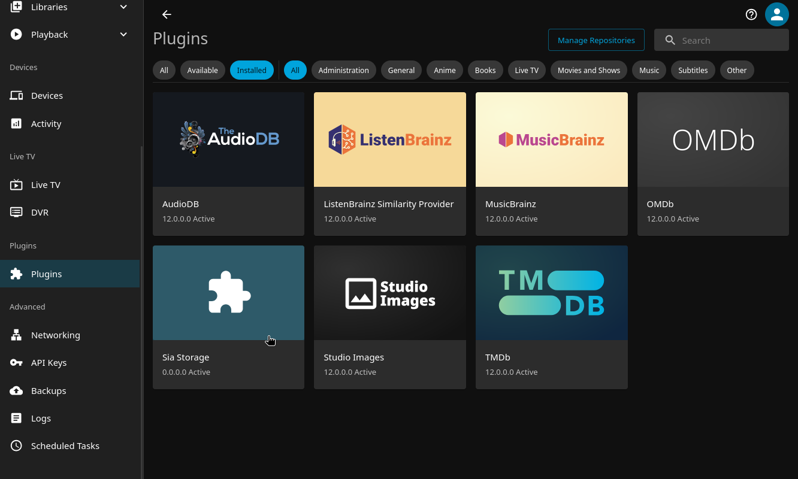
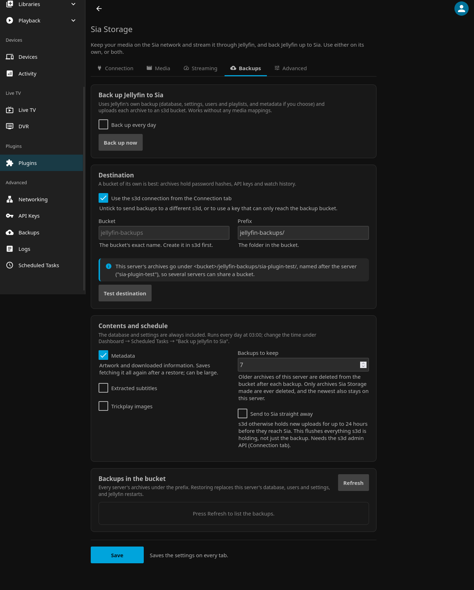
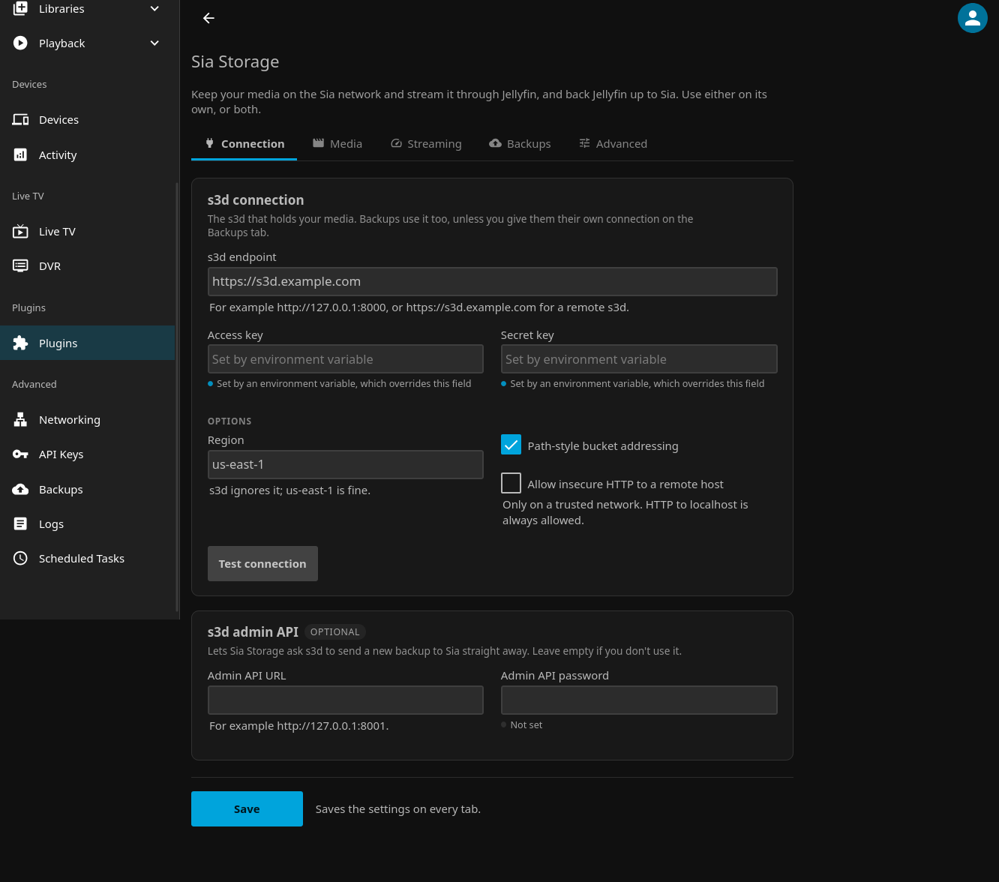
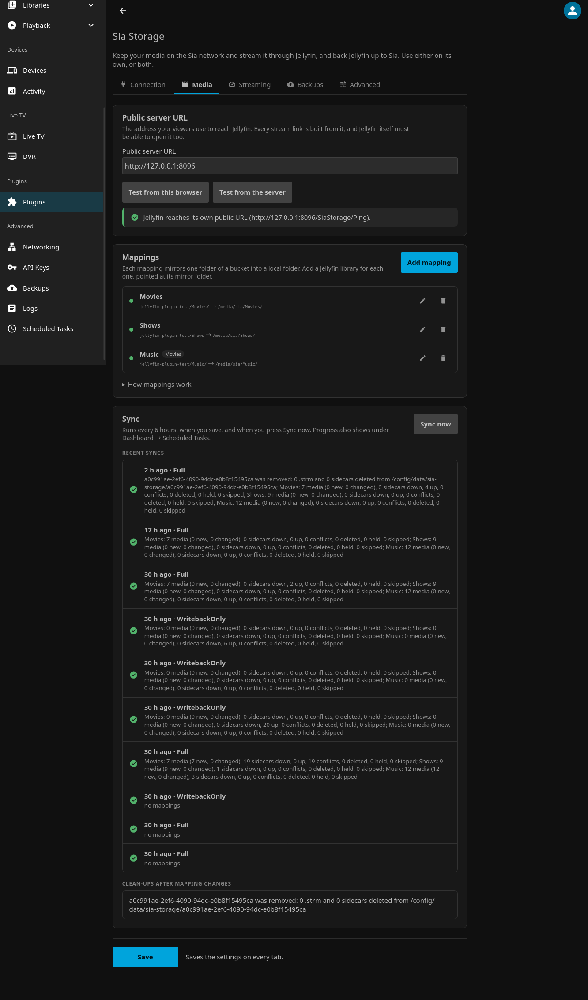

# Sia Storage for Jellyfin: alpha test

Thanks for testing **Sia Storage**, a Jellyfin plugin that uses the [Sia](https://sia.tech) storage network through
[s3d](https://github.com/SiaFoundation/s3d), Sia's S3-compatible gateway. It does two things, and you can test either
one on its own:

- **Media on Sia:** keep movies, shows and music in an s3d bucket, and watch them in Jellyfin as normal libraries.
- **Backups to Sia:** back Jellyfin's database and settings up to an s3d bucket every day, and restore them from the
  plugin page.

> **This is an alpha.** It works on our test servers, but expect rough edges. Test on a server you can afford to
> break, or keep your own backup of Jellyfin's data folder. The plugin never deletes media from your bucket.

This repository only holds the releases and this guide. Report problems and ideas in its
[Issues](../../issues/new/choose).

## Contents

- [What you need](#what-you-need)
- [Install](#install)
- [Set up backups](#set-up-backups)
- [Set up media](#set-up-media)
- [What to test](#what-to-test)
- [Known issues](#known-issues)
- [Report a problem](#report-a-problem)
- [Update or uninstall](#update-or-uninstall)
- [License and source code](#license-and-source-code)

## What you need

- **Jellyfin 12.0 to 12.4.** Older versions don't show the plugin.
- **s3d**, running and logged in to a Sia account, with an **access key and secret key**. See
  [s3d's README](https://github.com/SiaFoundation/s3d) to set it up.
- **A bucket** for backups, and one for media if you test that, for example made with `rclone mkdir s3d:jellyfin-backups`.
- For media: Jellyfin's **public server URL**, the address your devices use to reach Jellyfin (for example
  `https://jellyfin.example.com` or `http://192.168.1.20:8096`). **Jellyfin must be able to open this URL itself**,
  not just your devices.

## Install

1. In Jellyfin, open **Dashboard → Plugins** and go to the plugin **repositories**. Depending on your Jellyfin
   version, that's a **Repositories** tab, or a **Manage repositories** button on the **Catalog**.
2. Add a repository:
   - **Name:** `Sia Storage alpha`
   - **URL:** `https://raw.githubusercontent.com/skunk-ink/jellyfin-plugin-siastorage-releases/main/manifest.json`
3. Open the **Catalog**, find **Sia Storage** (under *General*), and install the newest version.
4. **Restart Jellyfin.** Under **Dashboard → Plugins**, *Sia Storage* now shows as *Active*. Its settings are under
   **Dashboard → Plugins → Sia Storage**.

   

> **Installed a build by hand before?** Stop Jellyfin and delete that copy first (usually a `SiaStorage` folder in
> Jellyfin's `plugins` folder), or Jellyfin loads two copies. Your settings and keys are kept elsewhere and survive.

**Jellyfin in Docker:** inside the container, `127.0.0.1` is the container itself. If s3d runs on the same machine,
run Jellyfin with `network_mode: host`, or use `http://host.docker.internal:8000` with
`extra_hosts: ["host.docker.internal:host-gateway"]`. The settings page warns you when this applies.

## Set up backups

You don't need any media mappings for this.

1. **Backups** tab: tick **Back up every day**, and enter the **Bucket**.
2. Choose the connection:
   - leave **Use the s3d connection from the Connection tab** ticked, and fill in the **Connection** tab; or
   - untick it to give backups their own s3d endpoint and keys, for example a key that can only reach the backup
     bucket.
3. **Save**, then **Test destination**. It writes and removes a small test object.
4. **Back up now.** The result shows at the top of the Backups tab when you reopen the page, and progress shows under
   **Dashboard → Scheduled Tasks**.

Backups then run every day at 03:00; change the time in **Scheduled Tasks → Back up Jellyfin to Sia**. Each archive
holds Jellyfin's database, settings, users and playlists (and metadata unless you untick it). It doesn't hold your
media, or Sia Storage's own settings.

> **Archives hold sensitive data**: password hashes, API keys and watch history. Use a bucket of their own.

## Set up media

1. **Connection** tab: enter the s3d endpoint (for example `http://127.0.0.1:8000`) and your keys. **Save**, then
   **Test connection**.

   
2. **Media** tab: enter the **public server URL**. **Save**, then **Test from the server**. It must say Jellyfin
   reaches its own URL; if not, follow the fixes it shows.
3. **Media** tab: **Add mapping** for each library, for example:

   | Name | Bucket | Prefix | Mirror folder | Content type |
   |---|---|---|---|---|
   | Movies | `media` | `Movies/` | `/media/sia/Movies` | Movies |
   | Shows | `media` | `Shows/` | `/media/sia/Shows` | Shows |
   | Music | `media` | `Music/` | `/media/sia/Music` | Music |

   Press **Check** in the dialog to see what's under the prefix (prefixes are case-sensitive), then **Done**, and
   **Save**. The first sync starts.
4. In **Dashboard → Libraries**, add one library per mapping, pointed at its mirror folder.

   

Name files in the bucket the way Jellyfin expects on disk, for example `Movies/Sintel (2010)/Sintel (2010).mkv` or
`Shows/Show Name/Season 01/S01E01 - Title.mp4`. Each mirror folder must be a new, empty folder of its own: the plugin
writes small `.strm` link files there.

## What to test

Anything you'd normally do is useful. In particular:

- **Install and setup:** was anything unclear on the settings page?
- **Video:** play, seek, switch audio and subtitle tracks, in the web client and at least one app (Android, iOS,
  TV). Does the first play start in reasonable time?
- **Music:** play albums, seek, lyrics (`.lrc` files next to the tracks).
- **Metadata:** do posters, NFO files and subtitles from the bucket show up? Do the ones Jellyfin downloads get
  uploaded back to the bucket after a sync?
- **Changing a mapping:** move its mirror folder, change its prefix, remove it. Does the page say clearly what will
  happen, and does it happen?
- **Backups:** back up now, let a few daily backups run, set **Backups to keep** to 2 and check older ones go.
- **Restore** (only on a server you can reset): **Backups in the bucket → Refresh → Restore**. Jellyfin restarts with
  the backed-up state.

## Known issues

- **First play from Sia is slower** than from a local disk; seeking and playing again are faster thanks to the cache.
- **No trickplay thumbnails or chapter images** for media on Sia: Jellyfin doesn't make these for `.strm` files.
- **Music** works through a fix inside the plugin, because Jellyfin 12.x only plays `.strm` links for video. If music
  says *the media is not supported by this client*, report it with your client and Jellyfin version.
- **Libraries aren't created for you.** Add them yourself, and re-point a library if you move a mapping's folder.
- **s3d holds new uploads for up to 24 hours** before they reach Sia, so a fresh backup only exists on the s3d machine
  until then. **Send to Sia straight away** (Backups tab, needs the s3d admin API) shortens that.
- The **settings page is new**. It hasn't been checked in Jellyfin's light theme yet.

## Report a problem

Open an [issue](../../issues/new/choose): **Bug report** for something broken, **Feedback or idea** for anything
else. Include:

- the plugin version (Dashboard → Plugins) and Jellyfin version;
- how Jellyfin runs (Docker or a package);
- for playback, which client;
- log lines: **Dashboard → Logs**, the lines with `SiaStorage` around the time it happened.

> **Never post keys, passwords or stream links.** A stream link (`…/SiaStorage/Stream/…?t=…`) lets anyone play that
> file. If one leaks, use **Advanced → Rotate link secret**.

## Update or uninstall

- **Update:** new alphas appear in the **Catalog** (Jellyfin also updates plugins automatically, unless you turned
  that off). Restart Jellyfin afterwards. Release notes are on the [Releases](../../releases) page.
- **Uninstall:** **Dashboard → Plugins → Sia Storage → Uninstall**, then restart Jellyfin. Remove the Jellyfin
  libraries that pointed at mirror folders. The plugin's own data stays in Jellyfin's data folder under
  `sia-storage/` (the mirror folders, unless you chose others, and `state/` with its database and keys); delete it
  if you don't plan to come back. Nothing in your buckets is touched.

## License and source code

Sia Storage is free software under the [GNU General Public License v3](LICENSE). If you received a release, you're
entitled to its source code: open a **Source code request** [issue](../../issues/new/choose) and you'll be given it.
